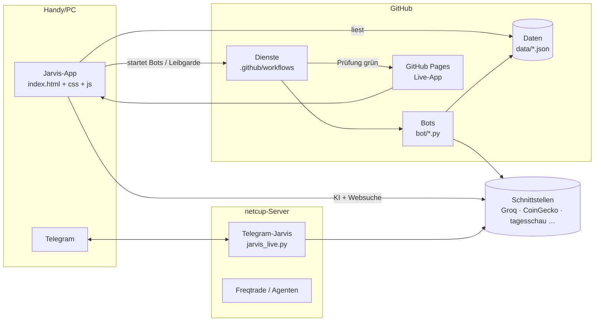

# Jarvis – Bauplan

## 1. Frontend – `index.html`, `css/`, `js/`
Reines HTML/CSS/JavaScript ohne Baukasten, läuft auf jedem Handy und offline (Service Worker `sw.js`).
Die Bausteine laden in Nummern-Reihenfolge; ein Baustein darf beim Laden nur Dinge aus Bausteinen mit **kleinerer** Nummer benutzen.

| Datei | Aufgabe |
|---|---|
| `01-basis.js` | Helfer, Speicher (localStorage + IndexedDB-Archiv), Tabs, Daten laden |
| `10-ki-stadt.js` | Tab „Stadt“: 3D-Stadt, jedes Haus ein Bot |
| `20-briefing.js` · `21-trading.js` · `22-neu-entdeckt.js` · `23-lage.js` | Tabs Briefing, Trading, Neu, Lage (Globus) |
| `24-automaton.js` | Jarvis-Topf (PayPal), Überlebens-Stufe, Kind-Bots, „Klonen? Ja/Nein“ |
| `30-feier-kalender.js` | „KUNDE AN BORD“-Feier, Kalender-Dateien (.ics) |
| `31-kunden.js` · `32-call.js` · `33-werkstatt.js` | Neuer Kunde, Call vorbereiten, Jarvis baut |
| `40-markdown.js` · `41-kern.js` | Formatierte Antworten, Partikel-Kern |
| `42-leibgarde.js` | Ben, Lea, Kai – Hintergrund-Aufträge |
| `43-gedaechtnis.js` · `44-ki-chat.js` · `45-stimme.js` | Gedächtnis-Sync, KI + Chat, Sprechen/Zuhören |
| `90-start.js` | Dialoge, Begrüßung, Start |

## 2. Backend – `bot/`, `video/`
| Bot | Datei | Wann | Schreibt |
|---|---|---|---|
| Leibgarde (Ben/Lea/Kai) | `hintergrund.py` | auf Abruf, eigene Warteschlange | `data/hintergrund/<id>.json` |
| Automaton Ava (PayPal-Topf, Spar-Stufen, Klone) | `automaton.py` | alle 2 h + auf Ja/Nein | `data/automaton.json` – siehe [AUTOMATON.md](AUTOMATON.md) |
| Agentin Ada (Lage) | `lage.py` | alle 2 h | `data/lage.json` |
| Butler Bruno (Briefing) | `briefing.py` | täglich 6:09 | `data/briefing.json` |
| Forscherin Frieda | `recherche.py` | nachts | `data/recherche.json` |
| Wächter Willi | `waechter.py` | stündlich | `data/status.json` |
| Trader Toni | `paper.py` | alle 15 Min | `data/paper.json` |
| Meme-Makler Max | `agents.py` | stündlich | `data/agents.json` |
| Scout Sam | `auftraege.py` | täglich | `data/auftraege.json` |
| Postbote Paul | `ideen.py` | alle 15 Min | `data/ideen.json` |
| Regisseurin Rita | `video_auto.py` + `video/` | täglich | Videos |
| Tüftler Theo | `backtest.py` | auf Abruf | `data/backtest*.json` |
| Telegram-Jarvis | `jarvis_live.py` | rund um die Uhr (Server) | Server-Dateien |

Gemeinsame Werkzeuge aller Bots: **`bot/jlib.py`** (GitHub-API, KI mit Websuche + Quellen, Telegram, JSON speichern) und **`bot/ki_router.py`** (KI-Weiche mit Ausweich-Anbietern).

Video-Grafik (`video/sim.py`): Verlaufs-Hintergrund mit Lichtschein, Einflug-Animationen, TikTok-Untertitel mit leuchtendem Wort, Konfetti beim Ergebnis; alles Wichtige bleibt außerhalb von TikToks Knöpfen (rechts) und Beschreibung (unten).

## 3. Datenbank – `data/`
JSON-Dateien im Repo: Bots schreiben, die App liest sie über `raw.githubusercontent.com` (≈ 5 Min Cache).
`bots.json` ist die Liste aller Bots (Name, Haus, Workflow) – App, Wächter und Briefing lesen daraus.
Persönliches liegt **nicht** im Klartext im Repo: das Gedächtnis wird in der App verschlüsselt (`data/gehirn.enc`, AES-GCM).
Gesprächs-Archiv, Bauten und Einstellungen bleiben nur auf dem Gerät (IndexedDB / localStorage).

## 4. Schnittstellen (APIs)
| Dienst | Wofür | Schlüssel |
|---|---|---|
| Groq | KI (gpt-oss-120b/20b), Websuche (`browser_search`), Spracherkennung | `GROQ_KEY` (GitHub-Secret + App ⚙️) |
| **KI-Weiche** (`bot/ki_router.py`) | springt ein, wenn Groq ausfällt: Gemini → OpenRouter (Gratis-Modelle) → Ollama (eigene KI) – nie Claude | `GEMINI_KEY`, `OPENROUTER_KEY`, `OLLAMA_URL` (alle optional) |
| GitHub REST | Bots starten, Daten lesen/schreiben, Leibgarde | `GITHUB_TOKEN` / App-Token ⚙️ |
| Telegram | Nachrichten an Lucas | `TG_TOKEN`, `TG_CHAT` |
| tagesschau, Deutsche Welle (RSS) | Weltnachrichten | – |
| CoinGecko, Frankfurter (EZB) | Krypto- und Devisenkurse | – |
| Kraken | Kurse für Spielgeld-Trading | – (Echtgeld: siehe `ECHTGELD.md`) |
| ElevenLabs | optionale Stimme | in der App ⚙️ |
| PayPal (nur lesen) | Jarvis-Topf: Kontostand + Eingänge | `PAYPAL_CLIENT_ID`, `PAYPAL_SECRET` |

Hinweis: `groq/compound` ist für dieses Groq-Konto gesperrt – die Websuche läuft über `browser_search` (automatischer Ausweichweg in `jlib.ki` und `44-ki-chat.js`).

## 5. Dienste – `.github/workflows/`
Jeder Bot hat einen Workflow mit eigener `concurrency`-Gruppe. Die **Leibgarde** nutzt pro Auftrag eine eigene Gruppe → startet immer sofort, egal was sonst läuft.

## 6. Überwachung
- **Wächter Willi** (`waechter.py`, stündlich): letzter Lauf jedes Bots, frische Daten, Live-App erreichbar, KI-Motor antwortet. Startet überfällige/fehlgeschlagene Bots selbst neu, meldet **neue** Probleme per Telegram, Ergebnis im Briefing-Tab.
- **Telegram-Jarvis** auf dem Server: Herzschlag alle 30 Min (Bots, Freqtrade, Festplatte).

## 7. Tests – `tests/`
- `test_bots.py`: Länder-Erkennung, Lage ohne KI, 3 parallele Telegram-Helfer, alle Python-Dateien und Daten gültig.
- `test_app.py`: App im echten Browser (Handy-Größe) – Chat, Websuche-Quellen, Lage, Stadt, Kunden-Onboarding, Call-Wecker, Werkstatt, Leibgarde, Archiv, Offline-Start. Alle Fremd-Dienste werden nachgestellt.

## 8. Veröffentlichung
`pruefung.yml` → grün → `app-veroeffentlichen.yml` kopiert **genau den geprüften Stand** in den Zweig `gh-pages` und kontrolliert, dass die Live-Seite ihn zeigt. Der Server holt neue Bot-Versionen alle 30 Min selbst (nur wenn sie sich fehlerfrei übersetzen lassen).

## Regeln für neuen Code
1. Neue App-Funktion = neuer Baustein in `js/` mit passender Nummer + Eintrag in `index.html` + Test in `tests/test_app.py`.
2. Neuer Bot = Datei in `bot/` (nutzt `jlib`) + Workflow + Eintrag in `data/bots.json` + Test in `tests/test_bots.py`.
3. Keine Schlüssel im Code. Kein echtes Geld ohne Lucas' Ja.
